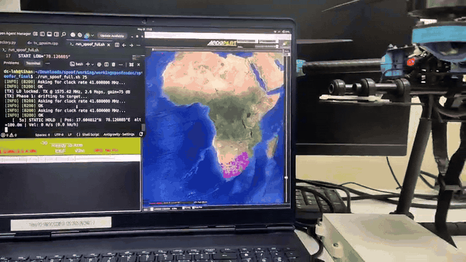
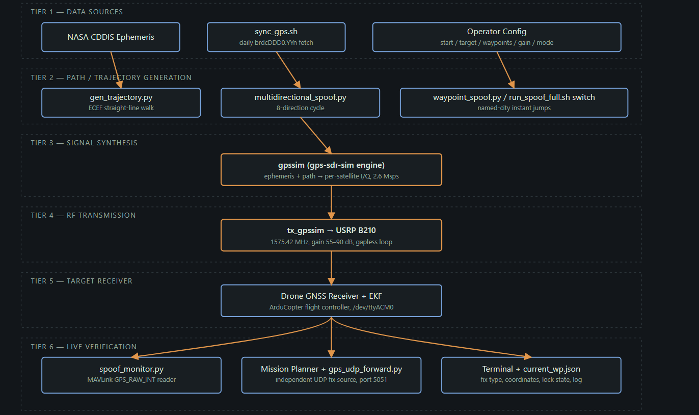
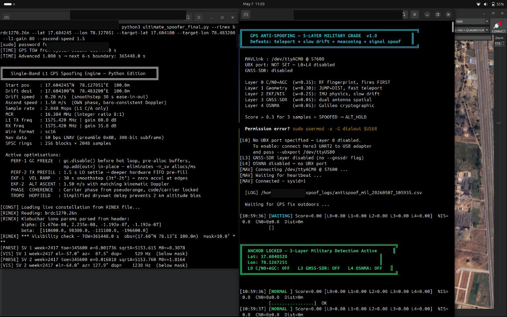
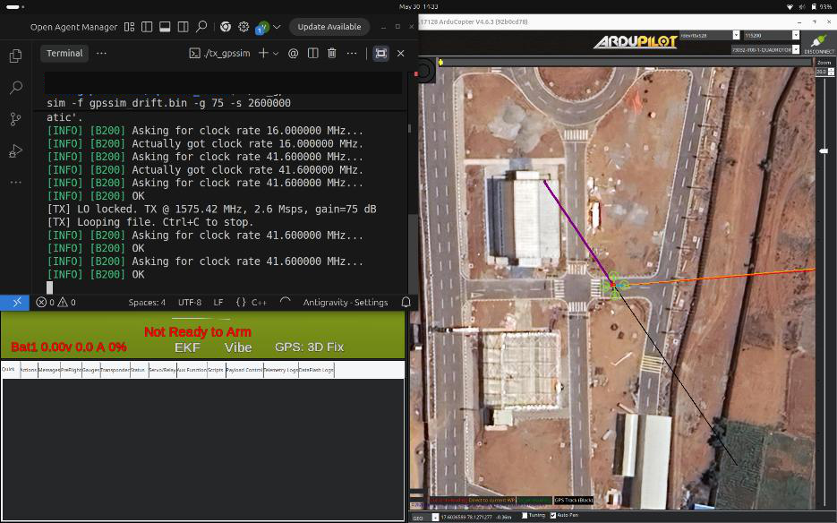
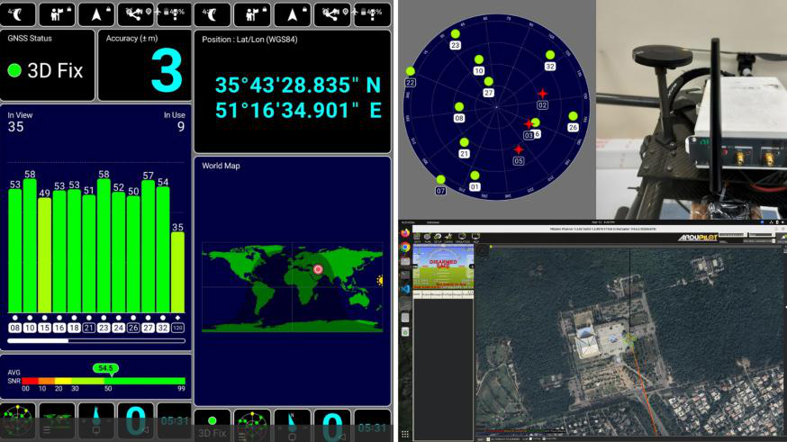
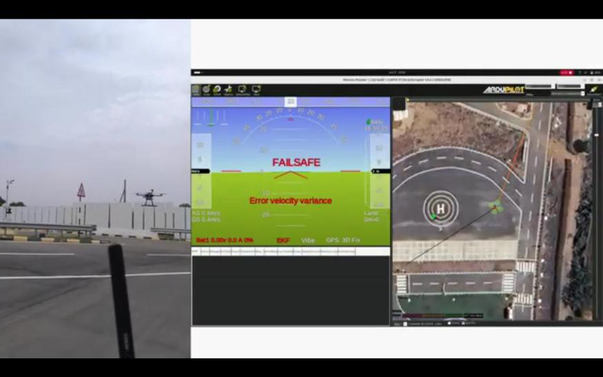
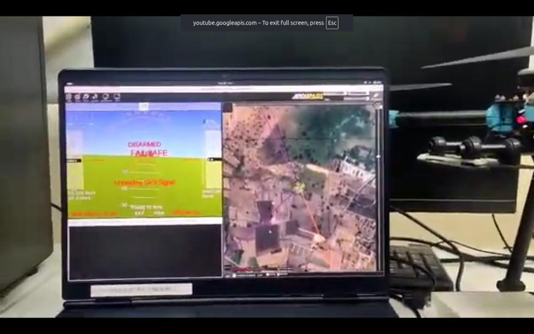
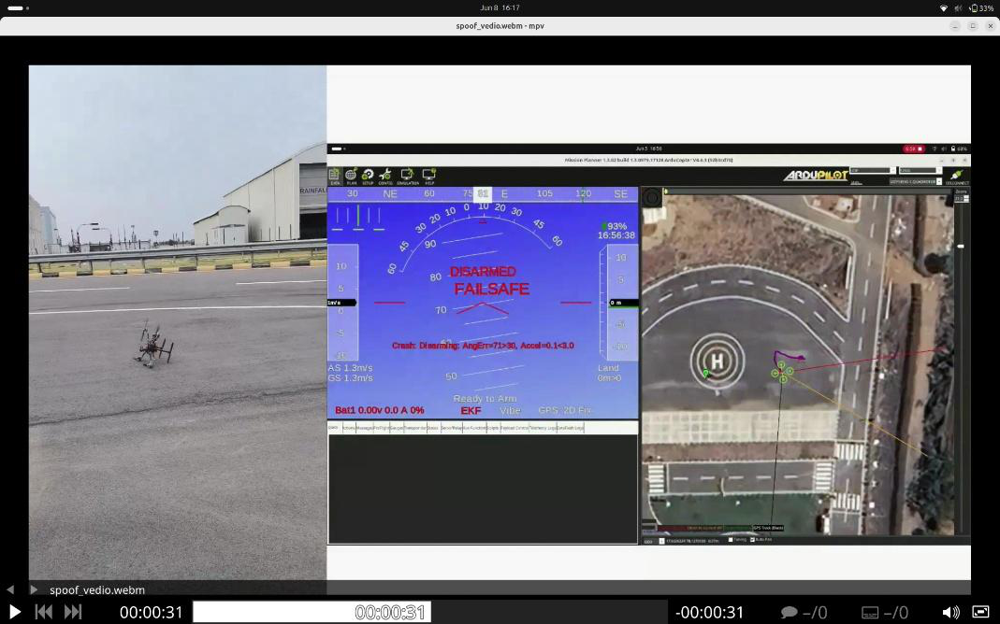
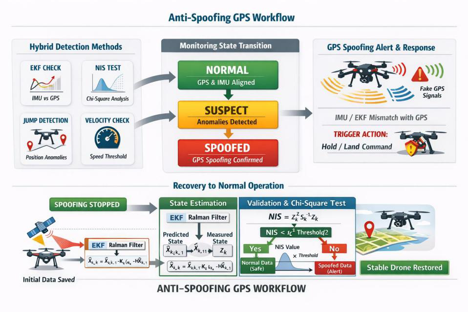
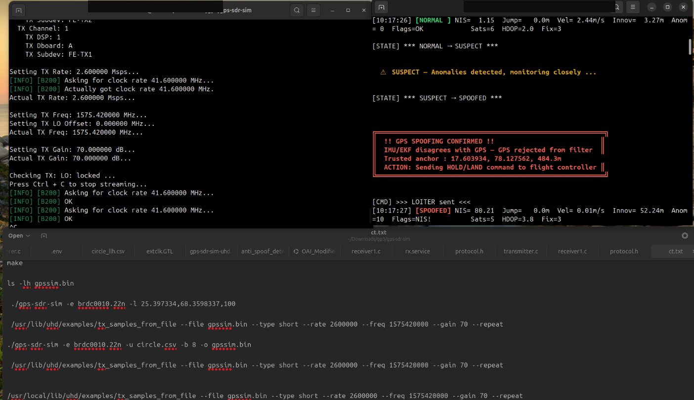

# GPS Spoofing & Anti-Spoofing for UAV Navigation Security

A research study of **GPS (GNSS L1 C/A) spoofing against drones** and a first-pass **detection framework**, built on a **USRP B210 software-defined radio**. The spoofer goes beyond a simple static/direct-jump attack: it moves a drone's perceived position **gradually**, at a velocity low enough to pass the flight controller's EKF gating — so the fake position is accepted without triggering a failsafe.

Work carried out at **TiHAN, IIT Hyderabad** as the navigation-layer part of a secure-UAV-communication project.

<p align="center">
  
  <br><em>The live bench — laptop running <code>run_spoof_full.sh</code> (terminal) with Mission Planner, the drone, and the USRP&nbsp;B210 SDR in frame; the spoofed location drifts on the map.</em>
  <br>▶️ Full clips (click to open GitHub's player): <a href="media/outdoor_flight_test.mp4"><b>outdoor flight test (drone airborne → FAILSAFE)</b></a> · <a href="media/indoor_spoof_test.mp4"><b>indoor bench test</b></a> · <a href="media/outdoor_drift_test.mp4"><b>drift pipeline</b></a>
</p>

<!-- ────────────────────────────────────────────────────────────────────────
     ▶ INLINE VIDEO — make the clip PLAY inside this page (optional):
       1. Open this README on github.com and click the ✏️ (Edit) button.
       2. Delete this whole comment block.
       3. Drag  media/indoor_spoof_test.mp4  (from your computer) onto the blank
          line below. GitHub uploads it and inserts a .../user-attachments/assets/…
          link that auto-embeds and plays here. Repeat for the outdoor clip.
     ──────────────────────────────────────────────────────────────────────── -->


> ⚠️ **Research / authorised-lab use only.** Every experiment here was run in a controlled environment at low transmit power (~13 dBm) to study the vulnerability and build countermeasures. **Broadcasting GPS signals over the air outside a shielded, authorised setup is illegal and dangerous** — it can disrupt aircraft, vehicles and phones over a wide area. Do not transmit without proper authorisation and RF containment.

📘 **Docs:** full method in [`docs/METHODOLOGY.md`](docs/METHODOLOGY.md) · verification report (rendered): **[open in browser](https://htmlpreview.github.io/?https://github.com/shivani708/gps-spoofing_for_UAV_communication/blob/main/docs/verification_report.html)** (GitHub shows the raw `.html` as code; this link renders it).

## Why this matters

Civilian GPS (L1 C/A, 1575.42 MHz) is **unencrypted and unauthenticated**. A receiver simply locks onto the strongest correctly-correlated signal, so a nearby SDR transmitting a standards-compliant synthetic signal at modest power is preferred over the real, much weaker satellites (ground level is around −130 dBm). Since drones depend on GPS for navigation and autonomous modes, this is a practical threat. This project builds the attack to understand it, then uses what it learns to detect it.

## System architecture

<p align="center"></p>

## Two spoofing implementations

### 1. File-based multi-hop drift pipeline (`gpssim` + `tx_gpssim`)

Generate an IQ file for a smoothly drifting trajectory, then stream it to the USRP:

```
gen_trajectory.py ──► trajectory_drift.csv ──► gpssim ──► gpssim_drift.bin ──► tx_gpssim ──► USRP B210 @ 1575.42 MHz
 (ECEF interpolation,     (lat lon alt,          (gps-sdr-sim,    (int16 IQ)       (streams, loops,
  hold then drift)         10 rows/s)             extended)                         zero-gap via pipe)
```

- **`gen_trajectory.py`** — builds the user-motion file. It holds the start position static for an acquisition window (so the receiver gets a clean 3D fix), then drifts toward the target at a constant speed. Interpolation is done in **ECEF Cartesian coordinates** and converted back to lat/lon/alt, so the spoofed altitude stays geodetically consistent instead of dipping below the Earth over long distances.
- **`gpssim.c` / `gpssim.h` / `gpssim_nav.h`** — the GPS L1 C/A baseband synthesiser, based on [gps-sdr-sim](https://github.com/osqzss/gps-sdr-sim) and extended for this work.
- **`tx_gpssim.cpp`** — USRP B210 IQ transmitter. Plays a single file, or reads int16 IQ from a **named pipe** for zero-gap continuous streaming (so the EKF never sees a position reset between chunks).
- **`gps-sdr-sim-uhd.py`** — alternative GNU Radio / UHD transmitter for the generated file.

### 2. Real-time single-band spoofing engine (`ultimate_spoofer`)

`ultimate_spoofer.cpp` + `TrajectoryModule.cpp/.h` synthesise the L1 signal **live** instead of from a pre-rendered file:

- **RX worker** listens at L1 and measures AGC power during a short LISTEN phase (to match the real signal level), then freezes.
- **DSP worker** drifts `current_pos` toward the target, computes per-satellite range/Doppler/code-phase with `TrajectoryModule`, synthesises L1 C/A with the 50 bps LNAV bit flips for 4 SVs, and scales amplitude.
- **TX worker** streams to the B210 (4.096 Msps, `sc8`, master clock 16.384 MHz).

`TrajectoryModule` implements the correct GPS code-phase formula (fractional chip count of the **transmit** time) and the IS-GPS-200H Klobuchar ionospheric delay model, so the receiver computes correct pseudoranges and actually reaches a 3D fix.

<p align="center"></p>
<p align="center"><em>Left: the real-time L1 engine starting — drift params, RINEX parse, per-SV visibility. Right: the companion multi-layer detector listening for the spoof.</em></p>

## The EKF constraint (why it drifts slowly)

The flight controller fuses IMU with GPS through an EKF. If the spoofed GPS velocity disagrees too much with the IMU, the EKF raises a large innovation and rejects the GPS, falling back to dead-reckoning and usually a failsafe. A gentle drift speed keeps the spoofed motion physically plausible so the EKF accepts it (the sample `spoof_drift.sh` holds a fix first, then drifts at 2 m/s).

## Testing results

Controlled lab and outdoor trials. L1 = 1575.42 MHz, USRP B210.

**Behaviour.** At ~13 dBm and gain 70, the spoofed signal overpowered the real GPS and created a **"3D Fix"** even where the genuine signal was unavailable. The reported position **drifted gradually** from the start toward the target (no sudden jump); on reaching the target the flight controller showed **"Unhealthy GPS"**, lost the fix, and disarmed. The effective spoofing range was increased from **15 m to 50 m** by tuning the USRP B210 analog + digital gain.

<p align="center">
  
  
  <br><em>Left: the drift pipeline running — Mission Planner shows "GPS: 3D Fix" and the spoofed ground track. Right: a receiver fully locked onto the spoofed position (note the foreign coordinates) with a healthy sky-plot.</em>
</p>

<p align="center">
  
  
  <br><em>Outdoor trials — as the spoofed position takes over, the flight controller flags <b>FAILSAFE / error velocity variance</b> and an <b>Unhealthy GPS</b> warning (the EKF rejecting the inconsistent GPS).</em>
</p>

**Progression:** static coordinate injection → multi-directional spoofing (forward / backward / left / right / diagonal, auto coordinate switching every 5 s) → dynamic trajectory (drift) spoofing. GPS position changes were validated live in **Mission Planner**. Also exercised against **BeiDou**.

**Real-time test runs:**

| # | Scenario | Distance | Lock (s) | CN0 (dB-Hz) | TX (dBm) | Pos. dev. (m) | Status |
|---|----------|:--------:|:--------:|:-----------:|:--------:|:-------------:|:------:|
| 1 | LoS | 5 m | 0.87 | 48.2 | 10 | 15.3 | ✓ |
| 2 | LoS + obstacle | 10 m | 0.94 | 44.8 | 12 | 22.7 | ✓ |
| 3 | NLoS | 15 m | 1.23 | 38.5 | 15 | 41.2 | ✓ |
| 4 | NLoS++ | 20 m | failed | 30.5 | 18 | — | ✗ |
| 5 | LoS + obstacle | 25 m | 0.76 | 42.1 | 20 | 78.1 | ✓ |

**Outdoor:** 5 trials — 3 achieved successful lock and coordinate drift; 2 showed delayed lock / signal fluctuation / GPS loss (mainly under the rainfall simulator). Spoofer-gain sweeps (20–89%) held a 3D fix with HDOP ≈ 0.01 and CN0 ≈ 38–39 dB-Hz. See the [outdoor flight test](media/outdoor_flight_test.mp4) — the drone is airborne over the runway when the spoof takes over and the flight controller trips **FAILSAFE / error velocity variance**.

<p align="center">
  
  <br><em>Runway trial — the drone on the tarmac (left) with the spoofed ground track drifting across the helipad map and DISARMED / FAILSAFE on the HUD (right).</em>
</p>

Sample artifacts are in [`results/`](results/) (`trajectory_drift.csv`, `positions_log.txt`). Full screenshots are in [`docs/figures/`](docs/figures/) and the recorded trials in [`media/`](media/).

## Ephemeris data (NASA CDDIS)

`gpssim` needs current GPS broadcast ephemeris (RINEX navigation file). `sync_gps.sh` downloads the day's `brdc` file from **NASA CDDIS** (`https://cddis.nasa.gov/archive/gnss/data/daily`).

> Requires a free **NASA Earthdata (URS)** account: https://urs.earthdata.nasa.gov/. Put your login in `~/.netrc` (never in the script) and `chmod 600 ~/.netrc`. `wget --netrc` reads it automatically.

## Anti-spoofing detection (companion work)

A hybrid **GPS + IMU + EKF** detection direction flags spoofing — including the hard gradual-drift case — using an **IMU-vs-GPS trajectory comparison**, a **velocity-consistency check**, a **jump check**, and **multi-sensor validation**, feeding a **Normal → Suspect → Spoofed** state machine that issues a HOLD/LAND fallback once spoofing is confirmed. Scope is **detection**, not automatic recovery of the true position. *The detection code is maintained separately and is not in this repository.*

<p align="center"></p>
<p align="center">
  
  <br><em>The detector in action: the state machine moves <b>NORMAL → SUSPECT → SPOOFED</b> as the NIS and consistency checks fire, then issues <b>"GPS SPOOFING CONFIRMED → HOLD/LAND"</b>.</em>
</p>

## Build

Requires UHD (USRP driver) with dev headers, a C/C++ toolchain, and Python 3.

```bash
# base gps-sdr-sim synthesiser
gcc -O3 -o gpssim gpssim.c -lm

# USRP IQ transmitter
g++ -std=c++17 -O2 -o tx_gpssim tx_gpssim.cpp $(pkg-config --cflags --libs uhd) -lpthread

# real-time engine
g++ -std=c++17 -O3 -march=native -o ultimate_spoofer \
    ultimate_spoofer.cpp TrajectoryModule.cpp \
    $(pkg-config --cflags --libs uhd) -lpthread -lm
```

## Run

```bash
# 1. Get today's ephemeris (needs ~/.netrc with NASA Earthdata login)
./sync_gps.sh

# 2. MAIN entry point — full multi-hop drift to any global target, then hold.
#    Edit START/TARGET coords at the top of the script, then:  ./run_spoof_full.sh [gain_dB]
./run_spoof_full.sh 75

# --- or run a single stage directly ---

# 2a. Single-hop drift: hold a 3D fix, then drift from start → target
#     args: start_lat start_lon start_alt  target_lat target_lon target_alt  gain_dB
./spoof_drift.sh 17.604012 78.126885 100  17.500000 78.200000 100  75

# 2b. Real-time engine only (terminal hold at target)
./ultimate_spoofer --lat 17.604012 --lon 78.126885 --l1-gain 15
```

`run_spoof_full.sh` is the orchestrator: it splits the distance into hops, double-buffers IQ generation (pre-generating the next hop while the current one transmits so there's no gap), logs each waypoint, and hands over to `ultimate_spoofer` for the final static hold. Full method in [`docs/METHODOLOGY.md`](docs/METHODOLOGY.md).

Monitor the effect on the target in **Mission Planner** (ArduPilot GCS, https://ardupilot.org/planner/) — watch the GPS fix, ground track, EKF status and any failsafe / velocity-variance warnings as the spoofed position takes over.

## Repository layout

```
ultimate_spoofer.cpp          real-time single-band L1 spoofing engine (RX/DSP/TX workers)
TrajectoryModule.cpp / .h     per-SV range, Doppler, code-phase, Klobuchar iono (IS-GPS-200H)
gpssim.c / gpssim.h / gpssim_nav.h   L1 C/A baseband synthesiser (extends gps-sdr-sim)
tx_gpssim.cpp                 USRP B210 IQ transmitter (file or zero-gap pipe streaming)
gps-sdr-sim-uhd.py            GNU Radio / UHD transmitter for the generated IQ file
gen_trajectory.py             hold-then-drift user-motion generator (ECEF interpolation)
run_spoof_full.sh             MAIN orchestrator: multi-hop drift (double-buffered) → terminal hold
spoof_drift.sh                single-hop drift pipeline (trajectory → IQ → transmit)
sync_gps.sh                   downloads NASA CDDIS RINEX broadcast ephemeris
docs/METHODOLOGY.md           full architecture, methodology, maths (Haversine, ECEF, EKF)
docs/verification_report.html bench verification report — GitHub shows it as source; see rendered link below
docs/figures/                 architecture diagrams + result screenshots
media/                        recorded trials: outdoor_flight_test (drone airborne), indoor/drift tests + preview GIF
results/trajectory_drift.csv  sample generated drift trajectory
results/positions_log.txt     sample multi-hop position log
```

> **Not included:** the generated IQ sample files (`*.bin`, ~12 GB), compiled binaries and the downloaded RINEX files — all git-ignored. Build the binaries and generate IQ locally.

## Hardware & tools

| | |
|---|---|
| SDR | USRP B210 (TX @ 1575.42 MHz, L1) |
| Transmit power | ~13 dBm (controlled lab) |
| Flight controller | CubePilot / ArduPilot, monitored via Mission Planner |
| Base signal engine | [gps-sdr-sim](https://github.com/osqzss/gps-sdr-sim) (extended) |
| Ephemeris | NASA CDDIS RINEX broadcast nav ([urs.earthdata.nasa.gov](https://urs.earthdata.nasa.gov/)) |

## References

- gps-sdr-sim — https://github.com/osqzss/gps-sdr-sim
- NASA CDDIS GNSS daily archive — https://cddis.nasa.gov/archive/gnss/data/daily/
- https://arxiv.org/pdf/2405.17925 · https://ieeexplore.ieee.org/document/7445815

**Author:** Shivani Reddy
